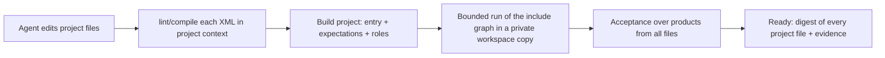

# Authoring project mode and project contract

Status: **proposed** (2026-10-20). Needs Alex's decision on the open questions below before
implementation. Shared with EE: the Build protocol is paired, so EE (datamimic-ee#69) adopts the
same contract.

## Context

Authoring today proves **one** XML file. A Build transaction carries one DM JSON document,
compiles it to one `compiled_xml` and certifies that file. The agent plugin follows suit: its
deliverable is `model.xml`, `model-review.md` and `model-proof.json`.

Real DATAMIMIC projects are not one file. `datamimic-demos` (for example `demo-py-scripting`,
`demo-database-basics`, `demo-insurance-claims-360`) use an entry descriptor that shows the
process and includes step files, plus `conf/`, `entity/*.ent.csv`, `weighting/*.wgt.csv`,
`script/*.scr.py|*.scr.sql` and `template/`. That split is the human review surface: business
data, parameters, custom logic and delivery each live in one place.

Evidence (2026-10-20, CE `aa0fbb3a`):

- **Blind tests.** 12 isolated agent sessions (no project context) built 6 scenarios. 11 reached
  Ready and their data was correct, but every project was a single XML file. Cross-table rules
  were satisfied only by construction, often through id arithmetic that a reviewer cannot follow.
- **Reference project.** The flight-school scenario was rebuilt by hand in the target structure.
  The real run met all rules R1–R5 and the negative cases, with no duplicates.
  Authoring could not prove it:

| Operation | Result |
|---|---|
| `lint` / `compile` ↔ `decompile` of the entry | works, including `execute` and comments |
| `dry-run` with includes, `.ent.csv`, memstore | works (#346) |
| `dry-run` with `<execute uri="script/*.scr.py">` | refused: no bounded policy (`dryrun.py`, #332) |
| `build` with any `<include>` | refused: `unsupported_bounded_operation`, even for `.properties` |
| `decompile` of a step file | judged standalone and rejected: seed, memstore and scripts belong to the entry |

Without a project-level proof, an agent that wants `outcome: ready` is pushed back into a
monolith. Steering in the plugin alone cannot fix that.

## Decision 1 — Project contract

A DATAMIMIC project is a directory with one entry descriptor. This layout is binding for agent
authoring and reviewed as one unit:

```
<project>/
├── datamimic.xml          entry: process comment, seed, clients, memstore, script loading, ordered includes
├── conf/                  base.properties (+ <env>.env.properties): parameters, connection settings
├── <n>_<activity>.xml     one step per activity, numbered in execution order
├── entity/*.ent.csv       business data and code lists
├── weighting/*.wgt.csv    distributions
├── script/*.scr.py        named pure functions with typed inputs and outputs
├── script/*.scr.sql       schema and delivery SQL
├── template/              document templates
└── README.md              purpose, process, rule → location table, evidence
```

Separation rules:

1. Business data and code lists live in `entity/` and `weighting/`, never as literals spread over
   XML. Fixed appointments (for example "who heads training") are data, not id arithmetic.
2. Parameters and connections live in `conf/` and the entry; step files never declare clients.
3. Generation steps write to a memstore. Delivery (export, insert, upsert, SQL) happens only in
   dedicated delivery steps, so the target can change without touching business logic.
4. Logic that spans tables is a named function in `script/`. All inputs are passed in from the
   model, so the function does not read state, and it returns its decisions; it fails loudly when a rule cannot be met.
5. The entry shows the process: one comment per step, includes in execution order.

## Decision 2 — Build project mode

Add a Build operation that proves a project rather than a document.



- **Input:** the entry path, expectations, product roles and verification options. The files in
  the workspace are the model; there is no second DM JSON copy of them.
- **Graph:** literal includes as in #346: `.xml` steps, `.properties`, and the resources they
  read. Expectations address products by name across all files; product names stay unique per project.
- **Proof binding:** Ready carries a digest per project file (XML, conf, entity, weighting, script).
  Any change to any of them invalidates the proof.
- **Project context for single files:** `lint`, `compile` and `decompile` of a step file use the
  entry's context (seed, memstore ids, properties, loaded script symbols), so a step is not judged
  as if it were standalone.
- **Diagnostics** name the file and line of the failing element in an included file. Values
  stay redacted; only file names, paths and element tags appear.

Recommended over the alternatives:

| Option | Choose when | Trade-off | Main risk |
|---|---|---|---|
| **Project Build over workspace files (recommended)** | the project files are the product | new operation; acceptance projection must read the XML graph | protocol change for CE and EE |
| Multiple DM JSON documents per transaction | agents must not edit XML directly | keeps the codec as the only writer | two representations of every file to keep in sync |
| Keep single-file Build, plugin splits afterwards | short term only | no engine change | the proof does not cover the delivered project |

## Decision 3 — Custom Python in bounded proof (#332)

Allow `<execute uri="script/*.scr.py">` in bounded runs when the module is a **pure function
library**. A static check of the module's AST before execution admits only these top-level
statements: docstring, imports from an allowlist (stdlib modules without I/O, `__future__`),
`def`/`class`, and constant assignments. Anything else is refused with a typed diagnostic that
names the file and the statement line.

The module runs in the bounded child that already isolates the workspace. `*.scr.sql` and
`execute target=<client>` stay refused in bounded proof; their delivery needs a real run with
readback, which is reported separately (target-isolated capture does not prove external delivery).

## Decision 4 — Plugin steering

The plugin's deliverable becomes the project tree:

- `references/project-structure.md` holds Decision 1. The workflow scaffolds the layout, writes data
  to `entity/`/`weighting/`, and keeps cross-table logic in `script/`.
- `review.md` reviews per file: purpose, inputs, outputs, rules located there. It keeps the
  requirement → location → evidence table and the project-wide proof.
- The engine pitfalls the reference project hit are part of the guidance until the engine fixes
  them: records are `DotableDict` (`get()`/attribute access, no item access), keys hold no lists,
  `<variable>` has no `min`/`max`, and a nested `count` evaluates in the enclosing record.

## Acceptance

1. The flight-school reference project reaches Ready through project Build. Its expectations
   cover R1, the volumes and the negatives, and an independent oracle confirms R2–R5.
2. A change to any project file invalidates the proof.
3. A failing element in a step file reports that file and line, without values.
4. A Python library with a top-level side effect (file write, network import) is refused and names the line.
5. Blind rerun (12 isolated sessions) scores project structure as well as correctness. The rubric
   covers layout, data in `entity/`/`weighting/` instead of literals, delivery steps separate from
   generation, and a readable entry process.

## Open questions for Alex

1. Is `datamimic-demos` the canonical layout, or does an EE/Platform convention take precedence?
2. Protocol: a new operation (`build-project`) beside `BuildRequestV4`, or a `V5` that supersedes it?
3. Order: EE first (EE leads shared boundary design) or CE first with a paired EE port?
4. Is the Python allowlist strict enough? `random`/`datetime` would be allowed; seeded randomness
   must come from the model, not the module.

## Not decided here

Cross-table expectation kinds (conditional composite foreign key, unique per filtered group,
multi-column duplicates, date ranges) are a separate decision. They make R2–R5 checkable as
expectations instead of only by an independent oracle.
