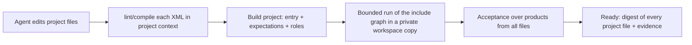

# Authoring project mode and project contract

Status: **decided in direction** (Alex, 2026-10-20): a new `BuildRequestV5` for CE and EE, CE
first and then EE (datamimic-ee#69); custom Python runs with safe globals. The project layout
below is a measured proposal that replaces the `datamimic-demos` layout as the reference.

## Context

Authoring today proves **one** XML file. A Build transaction carries one DM JSON document,
compiles it to one `compiled_xml` and certifies that file. The agent plugin follows suit: its
deliverable is `model.xml`, `model-review.md` and `model-proof.json`.

Real DATAMIMIC projects are not one file. `datamimic-demos` (for example `demo-py-scripting`,
`demo-database-basics`, `demo-insurance-claims-360`) use an entry descriptor that shows the
process and includes step files, plus `conf/`, `entity/*.ent.csv`, `weighting/*.wgt.csv`,
`script/*.scr.py|*.scr.sql` and `template/`. That split is the human review surface: business
data, parameters, custom logic and delivery each live in one place.

Evidence (2026-10-20, CE `aa0fbb3a`):

- **Blind tests.** 12 isolated agent sessions (no project context) built 6 scenarios. 11 reached
  Ready and their data was correct, but every project was a single XML file. Cross-table rules
  were satisfied only by construction, often through id arithmetic that a reviewer cannot follow.
- **Reference project.** The flight-school scenario was rebuilt by hand in the target structure.
  The real run met all rules R1–R5 and the negative cases, with no duplicates.
  Authoring could not prove it:

| Operation | Result |
|---|---|
| `lint` / `compile` ↔ `decompile` of the entry | works, including `execute` and comments |
| `dry-run` with includes, `.ent.csv`, memstore | works (#346) |
| `dry-run` with `<execute uri="script/*.scr.py">` | refused: no bounded policy (`dryrun.py`, #332) |
| `build` with any `<include>` | refused: `unsupported_bounded_operation`, even for `.properties` |
| `decompile` of a step file | judged standalone and rejected: seed, memstore and scripts belong to the entry |

Without a project-level proof, an agent that wants `outcome: ready` is pushed back into a
monolith. Steering in the plugin alone cannot fix that.

## Decision 1 — Project contract

A DATAMIMIC project is a directory with one entry descriptor. The `datamimic-demos` layout was the
starting point. The layout below improves it in three ways:
- folders separate *what* is generated from *where* it goes;
- numbering leaves gaps so steps can be inserted later;
- the acceptance inputs become project files instead of being lost after every Build.

```
<project>/
├── datamimic.xml                entry: process comment, seed, clients, memstore, lib loading, ordered includes
├── conf/                        base.properties (+ <env>.env.properties): parameters, connection settings
├── model/<nn>_<activity>.xml    business generation, one activity per file, numbered 10, 20, 30 …
├── delivery/<nn>_<target>.xml   export, insert, upsert into targets, numbered 90+; the only writers
├── data/
│   ├── entity/*.ent.csv         business data and code lists
│   ├── weighting/*.wgt.csv      distributions
│   └── fixtures/*.ent.csv       explicitly chosen cases (appointments, edge cases behind negatives)
├── lib/*.scr.py                 named pure functions with typed inputs and outputs (safe globals)
├── sql/*.scr.sql                schema, cleanup and delivery SQL
├── template/                    document templates
├── acceptance/
│   ├── build.json               expectations, product roles and verification for this project
│   └── *_oracle.py | *.sql      independent checks for rules no expectation can express yet
└── README.md                    purpose, process, rule → location table, evidence
```

Measured on the flight-school reference project. `model/`, `delivery/`, `data/` and `lib/`
resolve relative to the entry (included contexts keep the entry directory). With the same seed
the output is byte-identical to the flat layout, and the independent oracle confirms R1–R5 and
all negatives.

Separation rules:

1. Business data and code lists live in `data/entity/` and `data/weighting/`, never as literals
   spread over XML. Deliberately chosen cases live in `data/fixtures/`, never in id arithmetic.
2. Parameters and connections live in `conf/` and the entry; `model/` files never declare clients.
3. `model/` writes only to the memstore. `delivery/` reads it and is the only place that writes to
   files, databases or brokers, so a target can change without touching business logic.
4. Logic that spans tables is a named function in `lib/`. All inputs are passed in from the model,
   so the function does not read state; it returns its decisions and fails loudly when a rule
   cannot be met.
5. The entry shows the process: one comment line per step, includes in execution order.
6. `acceptance/build.json` is the single source of the project's acceptance. Editing XML no
   longer loses the requirements, because they no longer exist only in the transaction.

## Decision 2 — Build project mode

Add a Build operation that proves a project rather than a document.



- **Protocol:** `BuildRequestV5`, CE first, then the paired EE port. Input: the project root and
  `acceptance/build.json` (entry path, expectations, product roles, verification). The files in the
  workspace are the model; there is no second DM JSON copy of them. `V4` stays for single-document
  callers until a migration is decided.
- **Graph:** literal includes as in #346: `.xml` steps, `.properties`, and the resources they
  read. Expectations address products by name across all files; product names stay unique per project.
  Facts that Build derives from the document must come from the resolved graph, not the entry alone.
  Example: whether a seeded model loads Python and therefore must replay (CE #360; Codex review).
- **Proof binding:** Ready carries a digest per project file (XML, conf, entity, weighting, script).
  Any change to any of them invalidates the proof.
- **Project context for single files:** `lint`, `compile` and `decompile` of a step file use the
  entry's context (seed, memstore ids, properties, loaded script symbols), so a step is not judged
  as if it were standalone.
- **Diagnostics** name the file and line of the failing element in an included file. Values
  stay redacted; only file names, paths and element tags appear.

Recommended over the alternatives:

| Option | Choose when | Trade-off | Main risk |
|---|---|---|---|
| **Project Build over workspace files (recommended)** | the project files are the product | new operation; acceptance projection must read the XML graph | protocol change for CE and EE |
| Multiple DM JSON documents per transaction | agents must not edit XML directly | keeps the codec as the only writer | two representations of every file to keep in sync |
| Keep single-file Build, plugin splits afterwards | short term only | no engine change | the proof does not cover the delivered project |

## Decision 3 — Custom Python with safe globals (#332)

`<execute uri="lib/*.scr.py">` loads a **library**: functions, plus classes for custom generators
and converters. It is not a script that does work when it loads. "Safe globals" means the
library sees the same seeded objects as DSL expressions. It does not restrict builtins.

- **Seeded names (CE #358, merged).** Under `rngSeed`, names bound to `random`, `uuid`,
  `datetime`, `pd`, `np`, `os` and to members imported by name are rebound after loading. They
  get the seeded stand-ins of `engine/runtime/scripting/expression_globals.py`, the CE mirror of
  EE ADR-031:
  - `random.Random` becomes a real seeded subclass, and `isinstance` checks keep working.
  - Entropy sources (`SystemRandom`, `uuid1`, `urandom`) and a keyed `random.seed(x)` raise.
  - Ordinary `import random` / `from datetime import datetime` therefore stay allowed.
- **Classes are admitted** (Alex, 2026-10-21), mostly `Generator`/`Converter` subclasses. Functions-only would make
  about half of the existing scripts unloadable.

Corpus, 2026-10-21: every `*.scr.py` in CE `datamimic_ce/` and `tests_ce/`, in `datamimic-demos`
and in `datamimic-ee`, deduplicated by content and without EE `.tmp/` run copies: 48 files.

| Defines a top-level class | Imports `random` | Imports `datetime` |
|---|---|---|
| 24 | 31 | 14 |

The #332 library check (CE PR #360) admits 39 of them unseeded and 24 seeded. The seeded refusals are
mostly `import random` inside `generate()`.
- **AST gate before execution.** Rebinding cannot reach two cases, CE #359:
  - draws while the module body runs;
  - imports inside function bodies.

  Implemented in CE PR #360, measured on the corpus. A static rule against load-time calls would also
  refuse deterministic code: loggers, NamedTuple constant tables. The split is therefore:
  - **static check** in the bounded child, on the exact bytes that run:
    - imports only data modules (`random`, `datetime`, `math`, `json`, `collections`, `faker`,
      `numpy`, `pandas`, `datamimic_ce.domains`, …);
    - no `open`/`eval`/`exec`/`compile`/`__import__`;
    - under rngSeed, no imports inside a function or class body.

    Each refusal names the file, line and rule, never values.
  - **forced replay:** Build always replays a seeded model that loads Python, so load-time draws fail
    as a replay mismatch.

Measured: the reference project's `lib/personnel.scr.py` loads and replays under rngSeed. The CE
#358 DSL fixture covers module imports, aliases, imports by name, `isinstance`, and a `generator=`
key that deep-copies the namespace. Each fails without the fix.

Safe globals are a contract for determinism and intent, not a security sandbox. The isolation
boundary stays the bounded child process with its private workspace. `sql/*.scr.sql` and
`execute target=<client>` stay outside bounded proof. Their delivery needs a real run with
readback, reported separately: target-isolated capture does not prove external delivery.

## Decision 4 — Plugin steering

The plugin's deliverable becomes the project tree:

- `references/project-structure.md` holds Decision 1. The workflow scaffolds the layout, writes data
  to `data/`, keeps cross-table logic in `lib/` and delivery in `delivery/`, and maintains
  `acceptance/build.json`.
- `review.md` reviews per file: purpose, inputs, outputs, rules located there. It keeps the
  requirement → location → evidence table and the project-wide proof.
- The engine pitfalls the reference project hit are part of the guidance until the engine fixes
  them: records are `DotableDict` (`get()`/attribute access, no item access), keys hold no lists,
  `<variable>` has no `min`/`max`, and a nested `count` evaluates in the enclosing record.

## Acceptance

1. The flight-school reference project reaches Ready through project Build. Its expectations
   cover R1, the volumes and the negatives, and an independent oracle confirms R2–R5.
2. A change to any project file invalidates the proof.
3. A failing element in a step file reports that file and line, without values.
4. A `lib/` module that imports outside the data modules, reads files, or (seeded) imports inside a
   body is refused and names the line. A seeded model with `lib/` always replays (CE #360).
5. Blind rerun (12 isolated sessions) scores project structure as well as correctness. The rubric
   covers layout, data in `entity/`/`weighting/` instead of literals, delivery steps separate from
   generation, and a readable entry process.

## Decisions taken (Alex, 2026-10-20)

1. Layout: the `datamimic-demos` structure was a starting idea; this document proposes the measured layout above.
2. Protocol: `BuildRequestV5` for CE and EE; CE first, then EE.
3. Python: allowed as pure libraries running with safe globals.

4. `lib/` admits classes (custom generators and converters), confirmed 2026-10-21.

Still open: when `V4` is retired.

## Not decided here

Cross-table expectation kinds (conditional composite foreign key, unique per filtered group,
multi-column duplicates, date ranges) are a separate decision. They make R2–R5 checkable as
expectations instead of only by an independent oracle.
